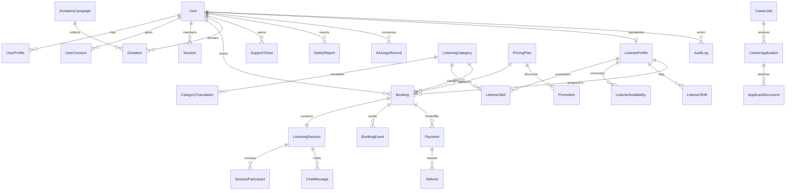

# ManMitra (मनमित्र) — Master System Architecture & Engineering Design

> **Brand Tagline**: “तुमचं मन. तुमच्या भावना. आमची साथ.”  
> **English Tagline**: “You Don’t Always Need Answers. Sometimes, You Just Need to Be Heard.”  
> **Mission**: A safe, respectful, empathetic, and confidential platform prioritizing non-judgmental listening, emotional peer support, and genuine human connection.

---

## 1. System Architecture Diagram

```mermaid
graph TB
    subgraph ClientLayer ["Client Layer (Web & Mobile Viewports)"]
        Browser["React 18 + Vite SPA (apps/web)\nTailwind CSS + Framer Motion + Lucide"]
        PWA["Responsive Mobile Viewport / PWA Shell"]
    end

    subgraph EdgeGateway ["Edge / Reverse Proxy & Security"]
        CDN["Vercel CDN / Cloudflare"]
        RateLimit["Rate Limiter & Abuse Guard\n(Redis / Memory Token Bucket)"]
        CORS["Strict CORS & Security Headers\n(Helmet, CSP, HSTS, SameSite Cookies)"]
    end

    subgraph CoreBackend ["Backend Services (apps/api - Modular Monolith)"]
        Express["Express.js / TypeScript App Engine (/api/v1)"]
        AuthModule["Auth & RBAC Module\n(Argon2id, HttpOnly JWT/Session)"]
        CategoryModule["Categories & Taxonomy Module"]
        ListenerModule["Listener Marketplace & Shifts Module"]
        BookingEngine["Booking & Scheduling Engine\n(Optimistic Locking + Conflict Prevention)"]
        PaymentModule["Payment & Ledger Service\n(Razorpay Orders, Webhooks, Integer Paise)"]
        DonationModule["Donation Service\n(Separate Philanthropic Ledger)"]
        AIOrchestrator["AI Orchestrator (Provider-Agnostic)\n(Gemini / OpenAI / Claude Adaptor + Safety Triage)"]
        SafetyModule["Safeguarding & Crisis Escalation Engine\n(Tele-MANAS, KIRAN 1800-599-0019)"]
        CallCenterOps["Call Centre & Operational Queue Engine\n(Live Queue, Supervisor Reassignment, IVR Adapter)"]
        CareersModule["Careers & ATS Portal Module"]
        AdminModule["Unified Admin & Audit Log Engine"]
    end

    subgraph AsyncWorker ["Background Tasks (apps/worker)"]
        QueueWorker["Background Worker\n(Booking Expiry, Email Notifications, Metric Rollups)"]
        SocketServer["Socket.IO Server\n(Real-Time Listening Chat & Live Queue Status)"]
    end

    subgraph PersistenceLayer ["Persistence & Cache Layer"]
        Postgres[(PostgreSQL / Neon Database\nPrisma ORM, Strict Foreign Keys)]
        RedisCache[(Redis Cluster / Cache\nSession Store, Rate Limits, Wait-Time Queues)]
        ObjectStorage[(S3-Compatible Object Storage\nResumes, Verified Listener Badges, Receipts)]
    end

    subgraph ExternalIntegrations ["External Third-Party Integrations"]
        LLMProvider["AI Providers\n(Google Gemini 2.0 / OpenAI / Anthropic)"]
        Razorpay["Razorpay Payment Gateway\n(Cards, UPI, Netbanking, Auto-Refunds)"]
        EmailService["Transactional Email\n(Resend / SMTP)"]
        TelephonyAdapter["Telephony / IVR Gateway (Future Phase)\n(Twilio / Exotel Adapter)"]
        CrisisHotlines["National Crisis Hotlines\n(Tele-MANAS 14416, KIRAN 1800-599-0019)"]
    end

    %% Client to Edge
    Browser --> CDN
    PWA --> CDN
    CDN --> RateLimit
    RateLimit --> CORS
    CORS --> Express

    %% Express to Modules
    Express --> AuthModule
    Express --> CategoryModule
    Express --> ListenerModule
    Express --> BookingEngine
    Express --> PaymentModule
    Express --> DonationModule
    Express --> AIOrchestrator
    Express --> SafetyModule
    Express --> CallCenterOps
    Express --> CareersModule
    Express --> AdminModule

    %% Modules to Persistence
    AuthModule & CategoryModule & ListenerModule & BookingEngine & PaymentModule & DonationModule & CareersModule & AdminModule --> Postgres
    RateLimit & CallCenterOps & BookingEngine --> RedisCache
    CareersModule & ListenerModule --> ObjectStorage

    %% Worker & Real-time
    Express -.-> QueueWorker
    QueueWorker --> Postgres
    QueueWorker --> RedisCache
    Express <--> SocketServer
    SocketServer <--> RedisCache

    %% External Connections
    AIOrchestrator --> LLMProvider
    PaymentModule & DonationModule --> Razorpay
    QueueWorker --> EmailService
    CallCenterOps -.-> TelephonyAdapter
    SafetyModule -.-> CrisisHotlines
```



---

## 2. User Journey and Role-Permission Matrix

### 2.1 User Journeys

#### Customer Journey 1: “मन मोकळं करा” (Instant AI Listening & Clarification)
1. User lands on Homepage, welcomed by peaceful aesthetic (Sage Green `#78917B`, Warm Cream `#F7F4ED`).
2. Reads the clear distinction: **AI Listening Assistant** vs **Human Emotional Listener**.
3. Clicks “मन मोकळं करा” -> Opens the ManMitra AI Listening Assistant.
4. Selects language: **Marathi (मराठी)**, **Hindi (हिंदी)**, or **English**.
5. AI welcomes the user empathetically without giving medical diagnoses or unsolicited advice.
6. Safety triage monitors every utterance. If distress indicators appear, crisis resources (Tele-MANAS 14416) are gently prioritized.
7. User feels heard, organizes their thoughts, and is offered an optional referral: *“Would you like to speak with a verified human listener who speaks Marathi?”*

#### Customer Journey 2: Human Listener Discovery & Booking
1. User browses **Explore Categories** (e.g., *Stress & Overthinking*, *Loneliness & Emotional Support*, *Family Concerns*).
2. Views **Meet Our Listeners** directory with badges (Languages, Verified Training, Bio, Pricing).
3. Selects listener -> Chooses session format (Text Chat or Audio Call) -> Selects date & slot.
4. If introductory offer applies (e.g. ₹1 Promotional Trial for new users), price calculates to 100 paise with transparent tax breakdown.
5. User completes Razorpay checkout (UPI, Card, NetBanking).
6. Backend verifies cryptographic signature before confirming booking. Double-booking is strictly prevented via Prisma serializable transactions.
7. User enters private session room at appointed time. Session completes; user provides voluntary emotional rating.

#### Listener Journey: Onboarding & Shift Management
1. Applicant applies via **Careers Portal** -> Recruiter reviews application & conducts peer-support empathy screening.
2. Approved candidate is assigned `LISTENER` role and completes ethical boundaries & safeguarding training.
3. Listener sets weekly availability slots, active categories, and languages spoken.
4. During shifts, Listener toggles status (`AVAILABLE`, `IN_SESSION`, `OFFLINE`) in Listener Dashboard.
5. Joins audio/text sessions with zero access to past customer transcripts or private customer data.

#### Supervisor / Operational Journey: Live Queue & Reassignment
1. `LISTENER_SUPERVISOR` views live call-center queue, average wait times, active sessions, and listener statuses.
2. In case of listener drop or emergency escalation, supervisor reassigns session to standby listener or initiates polite customer callback.
3. Supervisor monitors flagged safety reports with strict audit logging.

---

### 2.2 Role-Based Access Control (RBAC) Matrix

| Resource / Capability | CUSTOMER | LISTENER | LISTENER_SUPERVISOR | SUPPORT_AGENT | CAREERS_RECRUITER | ADMIN | SUPER_ADMIN |
| :--- | :---: | :---: | :---: | :---: | :---: | :---: | :---: |
| **Browse Categories & Listeners** | Read | Read | Read | Read | Read | Read | Read |
| **Use ManMitra AI Listening** | Read/Create | - | - | - | - | Test | Test/Config |
| **Book & Pay for Sessions** | Own | - | - | - | - | - | - |
| **Manage Listener Profile & Shifts** | - | Own | Manage | - | - | Manage | Manage |
| **Conduct Listening Sessions** | Own | Assigned | - | - | - | - | - |
| **Live Call-Center Ops & Queue** | - | - | View/Assign | View | - | Full | Full |
| **Customer Support Tickets** | Own | - | View | Manage | - | Manage | Full |
| **Careers & Job Postings** | View/Apply | View | View | View | Manage | Manage | Full |
| **Applicant Review & ATS** | - | - | - | - | Full | Full | Full |
| **Manage Pricing & ₹1 Offers** | - | - | - | - | - | Manage | Full |
| **Donations Management** | Donate/History | - | - | - | - | View/Manage | Full |
| **Safeguarding & Safety Reports** | Report | Report | Triage | View | - | Manage | Full |
| **AI Cost & Quota Monitoring** | - | - | - | - | - | Read | Full |
| **System Settings & Audit Logs** | - | - | - | - | - | Read | Full |

---

## 3. Database Entity Relationship (ER) Diagram



---

## 4. Complete Folder Structure

```
manmitra/
├── apps/
│   ├── web/                         # React 18 + Vite Frontend
│   │   ├── public/                  # Favicons, manifests, static assets
│   │   ├── src/
│   │   │   ├── assets/              # SVGs, brand illustrations
│   │   │   ├── components/
│   │   │   │   ├── ui/              # Button, Card, Dialog, Input, Badge, etc.
│   │   │   │   ├── layout/          # Navbar, Footer, MobileMenu, AppShell
│   │   │   │   ├── shared/          # LanguageSwitcher, CrisisBanner, SEOHead
│   │   │   │   └── forms/           # FormField, SelectField, PhoneField
│   │   │   ├── features/
│   │   │   │   ├── auth/            # Login, Register, ForgotPassword, ResetPassword
│   │   │   │   ├── home/            # Hero, HowItWorks, Philosophy, PricingPreview
│   │   │   │   ├── categories/      # CategoryGrid, CategoryDetail, Suggestions
│   │   │   │   ├── ai-assistant/    # ManMitraAIChat, EmotionPills, SafeFallback
│   │   │   │   ├── listeners/       # ListenerDirectory, ListenerCard, ListenerDetail
│   │   │   │   ├── bookings/        # SlotPicker, BookingModal, Confirmation
│   │   │   │   ├── payments/        # RazorpayCheckout, PaymentSuccess, RefundView
│   │   │   │   ├── donations/       # DonationForm, CampaignProgress, Receipts
│   │   │   │   ├── careers/         # JobList, JobDetail, ApplicationForm
│   │   │   │   ├── dashboard/       # CustomerPortal, SessionHistory, ProfileEdit
│   │   │   │   ├── listener-desk/   # ListenerPortal, ShiftToggle, SessionRoom
│   │   │   │   ├── call-center/     # LiveQueue, SupervisorDesk, Reassignment
│   │   │   │   ├── admin/           # Users, Pricing, AuditLogs, AIUsage, Reports
│   │   │   │   └── support/         # ContactUs, TicketForm, EmergencyResources
│   │   │   ├── hooks/               # useAuth, useAI, useBooking, useSocket
│   │   │   ├── lib/                 # apiClient, queryClient, utils, constants
│   │   │   ├── routes/              # AppRoutes, ProtectedRoute, RoleGuard
│   │   │   ├── types/               # Local UI types
│   │   │   ├── App.tsx              # Root component with Providers
│   │   │   ├── index.css            # Tailwind + Brand Design System tokens
│   │   │   └── main.tsx             # Entrypoint
│   │   ├── package.json
│   │   ├── tailwind.config.ts
│   │   ├── tsconfig.json
│   │   └── vite.config.ts
│   │
│   ├── api/                         # Express.js + TypeScript Backend
│   │   ├── src/
│   │   │   ├── config/              # env.ts, prisma.ts, redis.ts, razorpay.ts
│   │   │   ├── constants/           # ErrorCodes, RoleEnums, CrisisContacts
│   │   │   ├── controllers/         # HTTP Controller definitions
│   │   │   │   ├── auth.controller.ts
│   │   │   │   ├── ai.controller.ts
│   │   │   │   ├── categories.controller.ts
│   │   │   │   ├── listeners.controller.ts
│   │   │   │   ├── bookings.controller.ts
│   │   │   │   ├── payments.controller.ts
│   │   │   │   ├── donations.controller.ts
│   │   │   │   ├── careers.controller.ts
│   │   │   │   ├── support.controller.ts
│   │   │   │   └── admin.controller.ts
│   │   │   ├── services/            # Pure Business Logic
│   │   │   │   ├── auth.service.ts
│   │   │   │   ├── ai/              # AI Orchestrator & Safety Filter
│   │   │   │   │   ├── ai-orchestrator.ts
│   │   │   │   │   ├── gemini.provider.ts
│   │   │   │   │   ├── safety-triage.ts
│   │   │   │   │   └── prompts.ts
│   │   │   │   ├── booking.service.ts
│   │   │   │   ├── payment.service.ts
│   │   │   │   ├── donation.service.ts
│   │   │   │   ├── call-center.service.ts
│   │   │   │   └── audit.service.ts
│   │   │   ├── middlewares/         # Auth, RBAC, Validate, RateLimit, Error
│   │   │   ├── routes/              # Express /api/v1 router aggregation
│   │   │   ├── sockets/             # Socket.IO handlers for chat & live queue
│   │   │   ├── utils/               # crypto.ts, logger.ts, response.ts
│   │   │   ├── app.ts               # Express application initialization
│   │   │   └── server.ts            # HTTP & Socket server bootstrap
│   │   ├── package.json
│   │   └── tsconfig.json
│   │
│   └── worker/                      # Background Queue & Scheduled Tasks
│       ├── src/
│       │   ├── jobs/                # bookingExpiry.ts, sessionCleanup.ts
│       │   └── worker.ts
│       ├── package.json
│       └── tsconfig.json
│
├── packages/
│   └── shared/                      # Isomorphic TypeScript Types & Schemas
│       ├── src/
│       │   ├── contracts/           # API Request/Response schemas
│       │   ├── enums/               # UserRole, BookingStatus, LanguageCode
│       │   └── schemas/             # Zod validation schemas
│       ├── package.json
│       └── tsconfig.json
│
├── prisma/                          # Database Definition & Seeders
│   ├── schema.prisma                # Normalized PostgreSQL schema
│   ├── seed.ts                      # 10 Categories, Listeners, Plans, Admin
│   └── migrations/
│
├── docs/                            # Architecture & Engineering Manuals
│   ├── ARCHITECTURE_AND_DESIGN.md
│   ├── API_SPECIFICATION.md
│   ├── SAFETY_AND_CRISIS_PROTOCOL.md
│   └── DEPLOYMENT_AND_RUNBOOK.md
│
├── .github/                         # CI/CD Workflows
│   └── workflows/
│       └── ci.yml
├── .env.example                     # Unified environment template
├── package.json                     # Monorepo root scripts (npm workspaces)
├── tsconfig.base.json
└── README.md
```
