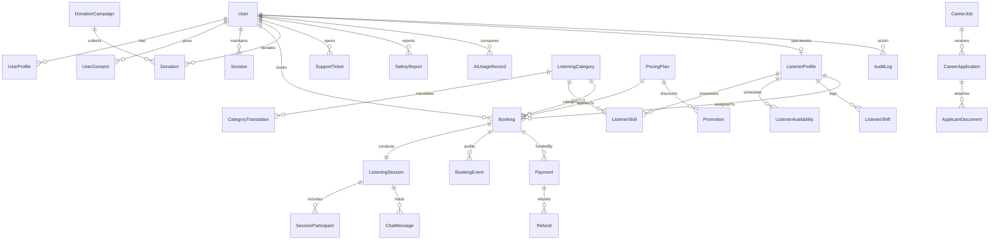
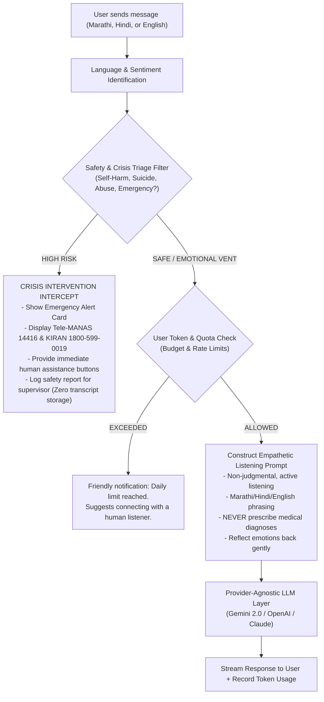
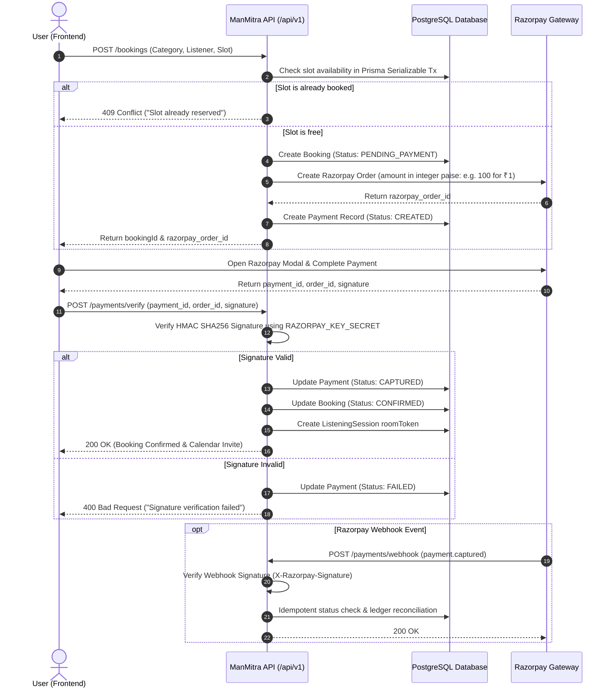

# ManMitra (मनमित्र) — Master System Architecture & Engineering Design

> **Brand Tagline**: “तुमचं मन. तुमच्या भावना. आमची साथ.”  
> **English Tagline**: “You Don’t Always Need Answers. Sometimes, You Just Need to Be Heard.”  
> **Mission**: A safe, respectful, empathetic, and confidential platform prioritizing non-judgmental listening, emotional peer support, and genuine human connection.

---

## 1. System Architecture Diagram

```mermaid
graph TB
    subgraph ClientLayer ["Client Layer (Web & Mobile Viewports)"]
        Browser["React 18 + Vite SPA (apps/web)\nTailwind CSS + Framer Motion + Lucide"]
        PWA["Responsive Mobile Viewport / PWA Shell"]
    end

    subgraph EdgeGateway ["Edge / Reverse Proxy & Security"]
        CDN["Vercel CDN / Cloudflare"]
        RateLimit["Rate Limiter & Abuse Guard\n(Redis / Memory Token Bucket)"]
        CORS["Strict CORS & Security Headers\n(Helmet, CSP, HSTS, SameSite Cookies)"]
    end

    subgraph CoreBackend ["Backend Services (apps/api - Modular Monolith)"]
        Express["Express.js / TypeScript App Engine (/api/v1)"]
        AuthModule["Auth & RBAC Module\n(Argon2id, HttpOnly JWT/Session)"]
        CategoryModule["Categories & Taxonomy Module"]
        ListenerModule["Listener Marketplace & Shifts Module"]
        BookingEngine["Booking & Scheduling Engine\n(Optimistic Locking + Conflict Prevention)"]
        PaymentModule["Payment & Ledger Service\n(Razorpay Orders, Webhooks, Integer Paise)"]
        DonationModule["Donation Service\n(Separate Philanthropic Ledger)"]
        AIOrchestrator["AI Orchestrator (Provider-Agnostic)\n(Gemini / OpenAI / Claude Adaptor + Safety Triage)"]
        SafetyModule["Safeguarding & Crisis Escalation Engine\n(Tele-MANAS, KIRAN 1800-599-0019)"]
        CallCenterOps["Call Centre & Operational Queue Engine\n(Live Queue, Supervisor Reassignment, IVR Adapter)"]
        CareersModule["Careers & ATS Portal Module"]
        AdminModule["Unified Admin & Audit Log Engine"]
    end

    subgraph AsyncWorker ["Background Tasks (apps/worker)"]
        QueueWorker["Background Worker\n(Booking Expiry, Email Notifications, Metric Rollups)"]
        SocketServer["Socket.IO Server\n(Real-Time Listening Chat & Live Queue Status)"]
    end

    subgraph PersistenceLayer ["Persistence & Cache Layer"]
        Postgres[(PostgreSQL / Neon Database\nPrisma ORM, Strict Foreign Keys)]
        RedisCache[(Redis Cluster / Cache\nSession Store, Rate Limits, Wait-Time Queues)]
        ObjectStorage[(S3-Compatible Object Storage\nResumes, Verified Listener Badges, Receipts)]
    end

    subgraph ExternalIntegrations ["External Third-Party Integrations"]
        LLMProvider["AI Providers\n(Google Gemini 2.0 / OpenAI / Anthropic)"]
        Razorpay["Razorpay Payment Gateway\n(Cards, UPI, Netbanking, Auto-Refunds)"]
        EmailService["Transactional Email\n(Resend / SMTP)"]
        TelephonyAdapter["Telephony / IVR Gateway (Future Phase)\n(Twilio / Exotel Adapter)"]
        CrisisHotlines["National Crisis Hotlines\n(Tele-MANAS 14416, KIRAN 1800-599-0019)"]
    end

    %% Client to Edge
    Browser --> CDN
    PWA --> CDN
    CDN --> RateLimit
    RateLimit --> CORS
    CORS --> Express

    %% Express to Modules
    Express --> AuthModule
    Express --> CategoryModule
    Express --> ListenerModule
    Express --> BookingEngine
    Express --> PaymentModule
    Express --> DonationModule
    Express --> AIOrchestrator
    Express --> SafetyModule
    Express --> CallCenterOps
    Express --> CareersModule
    Express --> AdminModule

    %% Modules to Persistence
    AuthModule & CategoryModule & ListenerModule & BookingEngine & PaymentModule & DonationModule & CareersModule & AdminModule --> Postgres
    RateLimit & CallCenterOps & BookingEngine --> RedisCache
    CareersModule & ListenerModule --> ObjectStorage

    %% Worker & Real-time
    Express -.-> QueueWorker
    QueueWorker --> Postgres
    QueueWorker --> RedisCache
    Express <--> SocketServer
    SocketServer <--> RedisCache

    %% External Connections
    AIOrchestrator --> LLMProvider
    PaymentModule & DonationModule --> Razorpay
    QueueWorker --> EmailService
    CallCenterOps -.-> TelephonyAdapter
    SafetyModule -.-> CrisisHotlines
```



---

## 2. User Journey and Role-Permission Matrix

### 2.1 User Journeys

#### Customer Journey 1: “मन मोकळं करा” (Instant AI Listening & Clarification)
1. User lands on Homepage, welcomed by peaceful aesthetic (Sage Green `#78917B`, Warm Cream `#F7F4ED`).
2. Reads the clear distinction: **AI Listening Assistant** vs **Human Emotional Listener**.
3. Clicks “मन मोकळं करा” -> Opens the ManMitra AI Listening Assistant.
4. Selects language: **Marathi (मराठी)**, **Hindi (हिंदी)**, or **English**.
5. AI welcomes the user empathetically without giving medical diagnoses or unsolicited advice.
6. Safety triage monitors every utterance. If distress indicators appear, crisis resources (Tele-MANAS 14416) are gently prioritized.
7. User feels heard, organizes their thoughts, and is offered an optional referral: *“Would you like to speak with a verified human listener who speaks Marathi?”*

#### Customer Journey 2: Human Listener Discovery & Booking
1. User browses **Explore Categories** (e.g., *Stress & Overthinking*, *Loneliness & Emotional Support*, *Family Concerns*).
2. Views **Meet Our Listeners** directory with badges (Languages, Verified Training, Bio, Pricing).
3. Selects listener -> Chooses session format (Text Chat or Audio Call) -> Selects date & slot.
4. If introductory offer applies (e.g. ₹1 Promotional Trial for new users), price calculates to 100 paise with transparent tax breakdown.
5. User completes Razorpay checkout (UPI, Card, NetBanking).
6. Backend verifies cryptographic signature before confirming booking. Double-booking is strictly prevented via Prisma serializable transactions.
7. User enters private session room at appointed time. Session completes; user provides voluntary emotional rating.

#### Listener Journey: Onboarding & Shift Management
1. Applicant applies via **Careers Portal** -> Recruiter reviews application & conducts peer-support empathy screening.
2. Approved candidate is assigned `LISTENER` role and completes ethical boundaries & safeguarding training.
3. Listener sets weekly availability slots, active categories, and languages spoken.
4. During shifts, Listener toggles status (`AVAILABLE`, `IN_SESSION`, `OFFLINE`) in Listener Dashboard.
5. Joins audio/text sessions with zero access to past customer transcripts or private customer data.

#### Supervisor / Operational Journey: Live Queue & Reassignment
1. `LISTENER_SUPERVISOR` views live call-center queue, average wait times, active sessions, and listener statuses.
2. In case of listener drop or emergency escalation, supervisor reassigns session to standby listener or initiates polite customer callback.
3. Supervisor monitors flagged safety reports with strict audit logging.

---

### 2.2 Role-Based Access Control (RBAC) Matrix

| Resource / Capability | CUSTOMER | LISTENER | LISTENER_SUPERVISOR | SUPPORT_AGENT | CAREERS_RECRUITER | ADMIN | SUPER_ADMIN |
| :--- | :---: | :---: | :---: | :---: | :---: | :---: | :---: |
| **Browse Categories & Listeners** | Read | Read | Read | Read | Read | Read | Read |
| **Use ManMitra AI Listening** | Read/Create | - | - | - | - | Test | Test/Config |
| **Book & Pay for Sessions** | Own | - | - | - | - | - | - |
| **Manage Listener Profile & Shifts** | - | Own | Manage | - | - | Manage | Manage |
| **Conduct Listening Sessions** | Own | Assigned | - | - | - | - | - |
| **Live Call-Center Ops & Queue** | - | - | View/Assign | View | - | Full | Full |
| **Customer Support Tickets** | Own | - | View | Manage | - | Manage | Full |
| **Careers & Job Postings** | View/Apply | View | View | View | Manage | Manage | Full |
| **Applicant Review & ATS** | - | - | - | - | Full | Full | Full |
| **Manage Pricing & ₹1 Offers** | - | - | - | - | - | Manage | Full |
| **Donations Management** | Donate/History | - | - | - | - | View/Manage | Full |
| **Safeguarding & Safety Reports** | Report | Report | Triage | View | - | Manage | Full |
| **AI Cost & Quota Monitoring** | - | - | - | - | - | Read | Full |
| **System Settings & Audit Logs** | - | - | - | - | - | Read | Full |

---

## 3. Database Entity Relationship (ER) Diagram



---

## 4. Complete Folder Structure

```
manmitra/
├── apps/
│   ├── web/                         # React 18 + Vite Frontend
│   │   ├── public/                  # Favicons, manifests, static assets
│   │   ├── src/
│   │   │   ├── assets/              # SVGs, brand illustrations
│   │   │   ├── components/
│   │   │   │   ├── ui/              # Button, Card, Dialog, Input, Badge, etc.
│   │   │   │   ├── layout/          # Navbar, Footer, MobileMenu, AppShell
│   │   │   │   ├── shared/          # LanguageSwitcher, CrisisBanner, SEOHead
│   │   │   │   └── forms/           # FormField, SelectField, PhoneField
│   │   │   ├── features/
│   │   │   │   ├── auth/            # Login, Register, ForgotPassword, ResetPassword
│   │   │   │   ├── home/            # Hero, HowItWorks, Philosophy, PricingPreview
│   │   │   │   ├── categories/      # CategoryGrid, CategoryDetail, Suggestions
│   │   │   │   ├── ai-assistant/    # ManMitraAIChat, EmotionPills, SafeFallback
│   │   │   │   ├── listeners/       # ListenerDirectory, ListenerCard, ListenerDetail
│   │   │   │   ├── bookings/        # SlotPicker, BookingModal, Confirmation
│   │   │   │   ├── payments/        # RazorpayCheckout, PaymentSuccess, RefundView
│   │   │   │   ├── donations/       # DonationForm, CampaignProgress, Receipts
│   │   │   │   ├── careers/         # JobList, JobDetail, ApplicationForm
│   │   │   │   ├── dashboard/       # CustomerPortal, SessionHistory, ProfileEdit
│   │   │   │   ├── listener-desk/   # ListenerPortal, ShiftToggle, SessionRoom
│   │   │   │   ├── call-center/     # LiveQueue, SupervisorDesk, Reassignment
│   │   │   │   ├── admin/           # Users, Pricing, AuditLogs, AIUsage, Reports
│   │   │   │   └── support/         # ContactUs, TicketForm, EmergencyResources
│   │   │   ├── hooks/               # useAuth, useAI, useBooking, useSocket
│   │   │   ├── lib/                 # apiClient, queryClient, utils, constants
│   │   │   ├── routes/              # AppRoutes, ProtectedRoute, RoleGuard
│   │   │   ├── types/               # Local UI types
│   │   │   ├── App.tsx              # Root component with Providers
│   │   │   ├── index.css            # Tailwind + Brand Design System tokens
│   │   │   └── main.tsx             # Entrypoint
│   │   ├── package.json
│   │   ├── tailwind.config.ts
│   │   ├── tsconfig.json
│   │   └── vite.config.ts
│   │
│   ├── api/                         # Express.js + TypeScript Backend
│   │   ├── src/
│   │   │   ├── config/              # env.ts, prisma.ts, redis.ts, razorpay.ts
│   │   │   ├── constants/           # ErrorCodes, RoleEnums, CrisisContacts
│   │   │   ├── controllers/         # HTTP Controller definitions
│   │   │   │   ├── auth.controller.ts
│   │   │   │   ├── ai.controller.ts
│   │   │   │   ├── categories.controller.ts
│   │   │   │   ├── listeners.controller.ts
│   │   │   │   ├── bookings.controller.ts
│   │   │   │   ├── payments.controller.ts
│   │   │   │   ├── donations.controller.ts
│   │   │   │   ├── careers.controller.ts
│   │   │   │   ├── support.controller.ts
│   │   │   │   └── admin.controller.ts
│   │   │   ├── services/            # Pure Business Logic
│   │   │   │   ├── auth.service.ts
│   │   │   │   ├── ai/              # AI Orchestrator & Safety Filter
│   │   │   │   │   ├── ai-orchestrator.ts
│   │   │   │   │   ├── gemini.provider.ts
│   │   │   │   │   ├── safety-triage.ts
│   │   │   │   │   └── prompts.ts
│   │   │   │   ├── booking.service.ts
│   │   │   │   ├── payment.service.ts
│   │   │   │   ├── donation.service.ts
│   │   │   │   ├── call-center.service.ts
│   │   │   │   └── audit.service.ts
│   │   │   ├── middlewares/         # Auth, RBAC, Validate, RateLimit, Error
│   │   │   ├── routes/              # Express /api/v1 router aggregation
│   │   │   ├── sockets/             # Socket.IO handlers for chat & live queue
│   │   │   ├── utils/               # crypto.ts, logger.ts, response.ts
│   │   │   ├── app.ts               # Express application initialization
│   │   │   └── server.ts            # HTTP & Socket server bootstrap
│   │   ├── package.json
│   │   └── tsconfig.json
│   │
│   └── worker/                      # Background Queue & Scheduled Tasks
│       ├── src/
│       │   ├── jobs/                # bookingExpiry.ts, sessionCleanup.ts
│       │   └── worker.ts
│       ├── package.json
│       └── tsconfig.json
│
├── packages/
│   └── shared/                      # Isomorphic TypeScript Types & Schemas
│       ├── src/
│       │   ├── contracts/           # API Request/Response schemas
│       │   ├── enums/               # UserRole, BookingStatus, LanguageCode
│       │   └── schemas/             # Zod validation schemas
│       ├── package.json
│       └── tsconfig.json
│
├── prisma/                          # Database Definition & Seeders
│   ├── schema.prisma                # Normalized PostgreSQL schema
│   ├── seed.ts                      # 10 Categories, Listeners, Plans, Admin
│   └── migrations/
│
├── docs/                            # Architecture & Engineering Manuals
│   ├── ARCHITECTURE_AND_DESIGN.md
│   ├── API_SPECIFICATION.md
│   ├── SAFETY_AND_CRISIS_PROTOCOL.md
│   └── DEPLOYMENT_AND_RUNBOOK.md
│
├── .github/                         # CI/CD Workflows
│   └── workflows/
│       └── ci.yml
├── .env.example                     # Unified environment template
├── package.json                     # Monorepo root scripts (npm workspaces)
├── tsconfig.base.json
└── README.md
```

---

## 5. API Specification (`/api/v1`)

### Standard Response Envelope
All API endpoints return standard JSON responses:
```json
{
  "success": true,
  "data": { ... },
  "message": "Optional localized status message",
  "meta": { "page": 1, "limit": 20, "total": 100 }
}
```
Error response:
```json
{
  "success": false,
  "error": {
    "code": "SLOT_CONFLICT",
    "message": "The requested time slot has just been reserved. Please select another slot.",
    "details": []
  }
}
```

### 5.1 Authentication (`/api/v1/auth`)
* `POST /auth/register` — Register customer with email/password, full name, language preference, and privacy consent.
* `POST /auth/login` — Authenticate, sets secure HTTP-only `manmitra_session` cookie and returns user profile.
* `POST /auth/logout` — Revokes session and clears cookies.
* `POST /auth/forgot-password` — Generates a time-limited secure reset token.
* `POST /auth/reset-password` — Resets password with valid token and hashes using Argon2id.
* `GET /auth/me` — Returns current authenticated user and role-permissions.

### 5.2 Categories & Taxonomy (`/api/v1/categories`)
* `GET /categories` — List active categories with localized names, descriptions, and icon keys.
* `GET /categories/:slug` — Detailed category info, suggested listener skills, and booking availability.

### 5.3 ManMitra AI Listening Assistant (`/api/v1/ai`)
* `POST /ai/chat` — Send user message in Marathi/Hindi/English. Evaluates safety triage, returns empathetic response, and logs token usage.
* `POST /ai/suggest-category` — Analyzes user's expressed situation and gently suggests 1–2 relevant listening categories (always optional).
* `POST /ai/feedback` — Submit thumbs up/down and notes on AI empathy quality.

### 5.4 Human Listener Marketplace (`/api/v1/listeners`)
* `GET /listeners` — Search verified listeners filtered by language, category, format (audio/chat), and rating.
* `GET /listeners/:id` — Public profile, bio, verified credentials, and rates.
* `GET /listeners/:id/availability` — Real-time available booking slots for the upcoming 14 days.

### 5.5 Bookings (`/api/v1/bookings`)
* `POST /bookings` — Create a provisional booking with atomic slot reservation (`PENDING_PAYMENT`).
* `GET /bookings` — List user's past and upcoming bookings with status badges.
* `GET /bookings/:id` — Get specific booking details, room token, and status.
* `POST /bookings/:id/cancel` — Cancel booking in accordance with Refund Policy.

### 5.6 Payments & Razorpay Integration (`/api/v1/payments`)
* `POST /payments/create-order` — Generates Razorpay Order with integer paise (`amount_in_paise: 100` for ₹1 promotional trial).
* `POST /payments/verify` — Verifies HMAC SHA256 signature (`razorpay_order_id`, `razorpay_payment_id`, `razorpay_signature`).
* `POST /payments/webhook` — Handles async Razorpay webhook events (`payment.captured`, `payment.failed`, `refund.processed`).

### 5.7 Donations & Community Support (`/api/v1/donations`)
* `GET /donations/campaigns` — Active community campaigns (e.g., *Sponsor a Student Session*, *Low-Income Fund*).
* `POST /donations/create-order` — Create donation payment intent (separate from commercial booking ledger).
* `GET /donations/history` — Logged-in donor contribution history and receipt downloads.

### 5.8 Careers & Hiring (`/api/v1/careers`)
* `GET /careers/jobs` — Browse open listener and operations positions.
* `GET /careers/jobs/:slug` — Job description, responsibilities, empathy requirements, and compensation.
* `POST /careers/applications` — Submit application with resume, language skills, and background statement.

### 5.9 Support & Safety Escalation (`/api/v1/support`)
* `POST /support/tickets` — Submit customer inquiry or assistance ticket.
* `POST /support/safety-report` — Flag a session or concern to safeguarding supervisors.
* `GET /support/emergency-contacts` — Returns official crisis hotlines (Tele-MANAS, KIRAN, Vandrevala Foundation).

### 5.10 Administration & Operations (`/api/v1/admin`)
* `GET /admin/users` — User management and role assignment.
* `GET /admin/listeners/verification` — Review pending listener applications and onboarding.
* `GET /admin/call-center/queue` — Real-time operational queue and active listener load.
* `POST /admin/call-center/reassign` — Reassign queue session to available listener.
* `GET /admin/analytics` — Platform metrics (active sessions, satisfaction, revenue in paise, donations).
* `GET /admin/ai/usage` — AI token consumption, cost breakdown, and daily quota monitoring.
* `GET /admin/audit-logs` — Immutable audit trail of administrative actions.

---

## 6. Complete Database Schema (Prisma)

```prisma
datasource db {
  provider = "postgresql"
  url      = env("DATABASE_URL")
}

generator client {
  provider = "prisma-client-js"
}

enum UserRole {
  CUSTOMER
  LISTENER
  LISTENER_SUPERVISOR
  SUPPORT_AGENT
  CAREERS_RECRUITER
  ADMIN
  SUPER_ADMIN
}

enum SessionFormat {
  TEXT_CHAT
  AUDIO_CALL
}

enum BookingStatus {
  PENDING_PAYMENT
  CONFIRMED
  QUEUED
  IN_PROGRESS
  COMPLETED
  CANCELLED
  EXPIRED
  REFUND_PENDING
  REFUNDED
}

enum PaymentStatus {
  CREATED
  AUTHORIZED
  CAPTURED
  FAILED
  REFUNDED
}

enum ListenerStatus {
  AVAILABLE
  BUSY
  IN_SESSION
  ON_BREAK
  OFFLINE
}

enum JobStage {
  SUBMITTED
  UNDER_REVIEW
  SHORTLISTED
  INTERVIEW
  SELECTED
  REJECTED
  WITHDRAWN
}

model User {
  id               String           @id @default(uuid())
  email            String           @unique
  passwordHash     String
  fullName         String
  phone            String?          @unique
  role             UserRole         @default(CUSTOMER)
  isEmailVerified  Boolean          @default(false)
  preferredLang    String           @default("mr") // mr, hi, en
  createdAt        DateTime         @default(now())
  updatedAt        DateTime         @updatedAt

  profile          UserProfile?
  consents         UserConsent[]
  sessions         Session[]
  bookings         Booking[]        @relation("CustomerBookings")
  donations        Donation[]
  supportTickets   SupportTicket[]
  safetyReports    SafetyReport[]   @relation("ReportedByUser")
  aiUsageRecords   AIUsageRecord[]
  auditLogs        AuditLog[]
  listenerProfile  ListenerProfile?

  @@index([email])
  @@index([role])
}

model UserProfile {
  id             String    @id @default(uuid())
  userId         String    @unique
  user           User      @relation(fields: [userId], references: [id], onDelete: Cascade)
  displayName    String?
  avatarUrl      String?
  city           String?
  state          String?
  bio            String?
  emergencyPhone String?
  createdAt      DateTime  @default(now())
  updatedAt      DateTime  @updatedAt
}

model UserConsent {
  id           String    @id @default(uuid())
  userId       String
  user         User      @relation(fields: [userId], references: [id], onDelete: Cascade)
  consentType  String    // TERMS, PRIVACY, DATA_PROCESSING, AI_USE
  granted      Boolean   @default(true)
  ipAddress    String?
  userAgent    String?
  timestamp    DateTime  @default(now())

  @@index([userId, consentType])
}

model Session {
  id           String    @id @default(uuid())
  userId       String
  user         User      @relation(fields: [userId], references: [id], onDelete: Cascade)
  tokenHash    String    @unique
  ipAddress    String?
  userAgent    String?
  expiresAt    DateTime
  createdAt    DateTime  @default(now())

  @@index([userId])
}

model ListeningCategory {
  id           String                @id @default(uuid())
  slug         String                @unique
  nameEn       String
  nameMr       String
  nameHi       String
  descEn       String
  descMr       String
  descHi       String
  iconKey      String                // Lucide icon identifier
  displayOrder Int                   @default(0)
  isActive     Boolean               @default(true)
  safetyNotice String?
  createdAt    DateTime              @default(now())
  updatedAt    DateTime              @updatedAt

  skills       ListenerSkill[]
  bookings     Booking[]
  translations CategoryTranslation[]

  @@index([slug])
  @@index([isActive, displayOrder])
}

model CategoryTranslation {
  id           String            @id @default(uuid())
  categoryId   String
  category     ListeningCategory @relation(fields: [categoryId], references: [id], onDelete: Cascade)
  locale       String            // mr, hi, en
  name         String
  description  String
  
  @@unique([categoryId, locale])
}

model ListenerProfile {
  id               String               @id @default(uuid())
  userId           String               @unique
  user             User                 @relation(fields: [userId], references: [id], onDelete: Cascade)
  displayName      String
  avatarUrl        String?
  headline         String
  bio              String
  languagesSpoken  String[]             // ["mr", "hi", "en"]
  isVerified       Boolean              @default(false)
  currentStatus    ListenerStatus       @default(OFFLINE)
  rating           Float                @default(5.0)
  totalSessions    Int                  @default(0)
  hourlyRatePaise  Int                  @default(9900) // stored in integer paise
  createdAt        DateTime             @default(now())
  updatedAt        DateTime             @updatedAt

  skills           ListenerSkill[]
  availabilities   ListenerAvailability[]
  shifts           ListenerShift[]
  bookings         Booking[]            @relation("ListenerBookings")

  @@index([isVerified, currentStatus])
}

model ListenerSkill {
  id          String            @id @default(uuid())
  listenerId  String
  listener    ListenerProfile   @relation(fields: [listenerId], references: [id], onDelete: Cascade)
  categoryId  String
  category    ListeningCategory @relation(fields: [categoryId], references: [id], onDelete: Cascade)

  @@unique([listenerId, categoryId])
}

model ListenerAvailability {
  id          String          @id @default(uuid())
  listenerId  String
  listener    ListenerProfile @relation(fields: [listenerId], references: [id], onDelete: Cascade)
  dayOfWeek   Int             // 0=Sun, 1=Mon, ..., 6=Sat
  startTime   String          // "09:00"
  endTime     String          // "17:00"
  isActive    Boolean         @default(true)

  @@index([listenerId, dayOfWeek])
}

model ListenerShift {
  id          String          @id @default(uuid())
  listenerId  String
  listener    ListenerProfile @relation(fields: [listenerId], references: [id], onDelete: Cascade)
  shiftStart  DateTime
  shiftEnd    DateTime?
  status      ListenerStatus  @default(AVAILABLE)

  @@index([listenerId, shiftStart])
}

model PricingPlan {
  id               String    @id @default(uuid())
  code             String    @unique // TRIAL_1_INR, STANDARD_20_MIN, EXTENDED_45_MIN
  title            String
  description      String
  durationMinutes  Int
  pricePaise       Int       // 100 for ₹1 offer
  isIntroductory   Boolean   @default(false)
  isActive         Boolean   @default(true)
  createdAt        DateTime  @default(now())

  bookings         Booking[]
}

model Booking {
  id               String             @id @default(uuid())
  bookingNumber    String             @unique // MB-YYYYMMDD-XXXX
  customerId       String
  customer         User               @relation("CustomerBookings", fields: [customerId], references: [id])
  listenerId       String?
  listener         ListenerProfile?   @relation("ListenerBookings", fields: [listenerId], references: [id])
  categoryId       String
  category         ListeningCategory  @relation(fields: [categoryId], references: [id])
  pricingPlanId    String
  pricingPlan      PricingPlan        @relation(fields: [pricingPlanId], references: [id])
  format           SessionFormat      @default(AUDIO_CALL)
  status           BookingStatus      @default(PENDING_PAYMENT)
  scheduledStart   DateTime
  scheduledEnd     DateTime
  actualStart      DateTime?
  actualEnd        DateTime?
  amountPaise      Int
  cancelledReason  String?
  createdAt        DateTime           @default(now())
  updatedAt        DateTime           @updatedAt

  session          ListeningSession?
  payments         Payment[]
  events           BookingEvent[]

  @@index([customerId, status])
  @@index([listenerId, scheduledStart])
  @@index([scheduledStart, scheduledEnd])
}

model BookingEvent {
  id          String         @id @default(uuid())
  bookingId   String
  booking     Booking        @relation(fields: [bookingId], references: [id], onDelete: Cascade)
  fromStatus  BookingStatus?
  toStatus    BookingStatus
  actorId     String?
  notes       String?
  timestamp   DateTime       @default(now())

  @@index([bookingId])
}

model ListeningSession {
  id              String               @id @default(uuid())
  bookingId       String               @unique
  booking         Booking              @relation(fields: [bookingId], references: [id], onDelete: Cascade)
  roomToken       String               @unique
  isActive        Boolean              @default(false)
  createdAt       DateTime             @default(now())
  endedAt         DateTime?

  participants    SessionParticipant[]
  messages        ChatMessage[]

  @@index([bookingId])
}

model SessionParticipant {
  id          String           @id @default(uuid())
  sessionId   String
  session     ListeningSession @relation(fields: [sessionId], references: [id], onDelete: Cascade)
  userId      String
  role        UserRole
  joinedAt    DateTime         @default(now())
  leftAt      DateTime?

  @@index([sessionId, userId])
}

model ChatMessage {
  id          String           @id @default(uuid())
  sessionId   String
  session     ListeningSession @relation(fields: [sessionId], references: [id], onDelete: Cascade)
  senderId    String
  content     String
  isSystem    Boolean          @default(false)
  sentAt      DateTime         @default(now())

  @@index([sessionId, sentAt])
}

model Payment {
  id               String        @id @default(uuid())
  bookingId        String?
  booking          Booking?      @relation(fields: [bookingId], references: [id])
  razorpayOrderId  String        @unique
  razorpayPaymentId String?      @unique
  razorpaySignature String?
  amountPaise      Int
  currency         String        @default("INR")
  status           PaymentStatus @default(CREATED)
  failureReason    String?
  createdAt        DateTime      @default(now())
  updatedAt        DateTime      @updatedAt

  refunds          Refund[]

  @@index([bookingId])
  @@index([razorpayOrderId])
}

model Refund {
  id               String    @id @default(uuid())
  paymentId        String
  payment          Payment   @relation(fields: [paymentId], references: [id])
  razorpayRefundId String?   @unique
  amountPaise      Int
  reason           String
  status           String    @default("PROCESSED") // INITIATED, PROCESSED, FAILED
  createdAt        DateTime  @default(now())

  @@index([paymentId])
}

model DonationCampaign {
  id          String     @id @default(uuid())
  slug        String     @unique
  title       String
  description String
  targetPaise Int
  raisedPaise Int        @default(0)
  isActive    Boolean    @default(true)
  createdAt   DateTime   @default(now())
  updatedAt   DateTime   @updatedAt

  donations   Donation[]

  @@index([isActive])
}

model Donation {
  id               String            @id @default(uuid())
  campaignId       String?
  campaign         DonationCampaign? @relation(fields: [campaignId], references: [id])
  userId           String?
  user             User?             @relation(fields: [userId], references: [id])
  donorName        String?
  donorEmail       String?
  amountPaise      Int
  isAnonymous      Boolean           @default(false)
  razorpayOrderId  String            @unique
  razorpayPaymentId String?          @unique
  receiptNumber    String            @unique
  createdAt        DateTime          @default(now())

  @@index([campaignId])
  @@index([userId])
}

model CareerJob {
  id             String              @id @default(uuid())
  slug           String              @unique
  title          String
  department     String
  location       String              @default("Remote / Maharashtra")
  employmentType String              // Full-time, Part-time, Flexible Shift
  languagesReq   String[]            // ["mr", "hi", "en"]
  description    String
  responsibilities String
  requirements   String
  trainingInfo   String
  isOpen         Boolean             @default(true)
  createdAt      DateTime            @default(now())
  updatedAt      DateTime            @updatedAt

  applications   CareerApplication[]

  @@index([isOpen])
}

model CareerApplication {
  id               String              @id @default(uuid())
  jobId            String
  job              CareerJob           @relation(fields: [jobId], references: [id])
  fullName         String
  email            String
  phone            String
  languagesSpoken  String[]
  motivationText   String
  stage            JobStage            @default(SUBMITTED)
  recruiterNotes   String?
  createdAt        DateTime            @default(now())
  updatedAt        DateTime            @updatedAt

  documents        ApplicantDocument[]

  @@index([jobId, stage])
}

model ApplicantDocument {
  id            String            @id @default(uuid())
  applicationId String
  application   CareerApplication @relation(fields: [applicationId], references: [id], onDelete: Cascade)
  fileKey       String
  fileName      String
  mimeType      String
  fileSize      Int
  uploadedAt    DateTime          @default(now())
}

model SupportTicket {
  id          String   @id @default(uuid())
  ticketNo    String   @unique
  userId      String?
  user        User?    @relation(fields: [userId], references: [id])
  name        String
  email       String
  subject     String
  message     String
  status      String   @default("OPEN") // OPEN, IN_PROGRESS, RESOLVED, CLOSED
  createdAt   DateTime @default(now())
  updatedAt   DateTime @updatedAt
}

model SafetyReport {
  id          String   @id @default(uuid())
  reportedBy  String?
  user        User?    @relation("ReportedByUser", fields: [reportedBy], references: [id])
  sessionId   String?
  severity    String   // HIGH_RISK, MEDIUM, LOW
  reason      String
  triageNotes String?
  isResolved  Boolean  @default(false)
  createdAt   DateTime @default(now())
  updatedAt   DateTime @updatedAt
}

model AIUsageRecord {
  id          String   @id @default(uuid())
  userId      String?
  user        User?    @relation(fields: [userId], references: [id])
  modelUsed   String
  tokensIn    Int
  tokensOut   Int
  durationMs  Int
  costPaise   Int      @default(0)
  language    String   @default("mr")
  createdAt   DateTime @default(now())

  @@index([userId, createdAt])
}

model AuditLog {
  id         String   @id @default(uuid())
  actorId    String?
  actor      User?    @relation(fields: [actorId], references: [id])
  action     String   // USER_ROLE_UPDATED, BOOKING_REFUNDED, SAFETY_ESCALATED
  resource   String
  resourceId String?
  details    String?
  ipAddress  String?
  timestamp  DateTime @default(now())

  @@index([action, timestamp])
}

model PlatformSetting {
  id          String   @id @default(uuid())
  key         String   @unique
  value       String
  description String?
  updatedAt   DateTime @updatedAt
}
```

---

## 7. UI Page Inventory & Navigation Map

### 7.1 Public Pages (14 Core Pages)
1. `/` — **Home**: Welcoming hero with Marathi & English taglines, primary CTA “मन मोकळं करा”, secondary CTA “Talk to a Listener”, Human vs AI distinction, 10 categories, introductory pricing overview, safety notices, and listener recruitment banner.
2. `/how-it-works` — **How It Works**: Visual 4-step explanation of finding a listener, picking an audio/text format, booking a safe private session, and experiencing unburdened listening.
3. `/categories` — **Explore Listening Categories**: Detailed view of all 10 emotional domains with empathetic guidance and listener matching.
4. `/listeners` — **Meet Our Listeners**: Directory of verified listeners with language badges (मराठी, हिंदी, English), specialties, bios, and direct booking triggers.
5. `/pricing` — **Pricing & Plans**: Transparent breakdown of introductory ₹1 trial, 20-min standard session, and 45-min extended sessions with zero hidden fees.
6. `/donations` — **Donations & Community Support**: Transparent community campaigns allowing patrons to sponsor sessions for students and low-income individuals.
7. `/about` — **About ManMitra**: Our origin story, Maharashtrian cultural context, founding ethos, and strict non-clinical emotional listening charter.
8. `/careers` — **Careers Portal**: Job openings for Emotional Listening Associates (Marathi/Hindi/English), Supervisors, and Support Staff.
9. `/contact` — **Contact Us**: Reach out for support, partnerships, or operational inquiries.
10. `/faqs` — **Frequently Asked Questions**: Clear answers regarding confidentiality, human vs AI capabilities, pricing, and audio/text formats.
11. `/privacy-policy` — **Privacy Policy**: Full Indian DPDP Act compliant privacy commitments, strict data retention, zero sale of personal stories, and consent controls.
12. `/terms` — **Terms & Conditions**: Clear boundary stating ManMitra is peer emotional listening, NOT therapy or medical treatment.
13. `/refund-policy` — **Refund & Cancellation Policy**: Clear, fair rules for cancellation and automatic payment refund workflows.
14. `/safety` — **Safety & Emergency Resources**: 24/7 National Mental Health Helpline (Tele-MANAS 14416), KIRAN (1800-599-0019), and crisis triage instructions.

### 7.2 Interactive App Modules
* `/ai-assistant` — Dedicated ManMitra AI Listening sanctuary (Chat interface with Marathi/Hindi/English switcher, empathetic open-ended prompts, zero judgment).
* `/book/:listenerId?` — Unified booking flow (Category selection -> Listener selection -> Format -> Slot selection -> Razorpay checkout).
* `/dashboard` — Customer dashboard with upcoming sessions, past history, and profile settings.
* `/listener/desk` — Listener workspace with status toggle (`AVAILABLE`, `OFFLINE`), upcoming appointments, and session room link.
* `/call-center/ops` — Live operational call-centre queue for supervisors and admins.
* `/admin` — Central Admin Dashboard (Users, Bookings, Payments, Donations, Careers, AI Costs, Audit Logs).

---

## 8. AI Integration & Safety Design



### Safety Policy Commitments
1. **Never clinical**: Explicitly states: *“I am ManMitra AI, an emotional listening companion. I am not a doctor or therapist.”*
2. **Marathi cultural empathy**: Capable of conversing naturally in Marathi with warmth (*“मी समजतोय, तुमचं मन खूप जड झालं आहे...”*), Hindi, and English.
3. **Strict crisis triage**: Words relating to suicide, self-harm, physical violence, or child abuse immediately trigger crisis helplines:
   * **Tele-MANAS**: `14416` or `1800-891-4416` (24x7 Government of India National Tele-Mental Health Programme)
   * **KIRAN**: `1800-599-0019`
   * **Vandrevala Foundation**: `9999 666 555`

---

## 9. Payment and Donation Workflows

### 9.1 Commercial Booking Payment Flow (Razorpay)



### 9.2 Transparent Introductory ₹1 Offer Terms
* **Unit Economics & Compliance**: Razorpay requires min ₹1 (100 paise) for standard card/UPI transactions.
* **Eligible Scope**: One-time introductory trial session per user to experience compassionate listening.
* **Clear Notice**: All fees, applicable taxes, and session length are explicitly displayed on checkout before payment. No hidden recurring subscriptions.
* **Separate Ledger**: Community donations are recorded in the `Donation` table and are completely isolated from commercial service revenues.

---

## 10. Development and Deployment Plan

| Phase | Module / Milestone | Key Deliverables | Status |
| :--- | :--- | :--- | :--- |
| **Phase 1** | **Foundation & Setup** | Monorepo structure (`apps/web`, `apps/api`, `packages/shared`, `prisma`), Tailwind design system with brand colors, unified TypeScript configs, Prisma PostgreSQL schema, initial migrations & seed data. | Initiated |
| **Phase 2** | **Public Website & Auth** | All 14 responsive public pages with Marathi/English typography, Navbar, Footer, Crisis Banner, Registration, Login, Argon2id hashing, secure cookies, and RBAC guards. | Current |
| **Phase 3** | **Listening Marketplace & Booking** | 10 Database-backed categories, verified listener profiles, interactive slot availability picker, atomic booking engine preventing double-booking. | Queued |
| **Phase 4** | **AI Listening Assistant** | Provider-agnostic AI service (Gemini 2.0 / OpenAI), Marathi/Hindi/English language support, crisis triage, token quotas, and non-judgmental prompt pipeline. | Queued |
| **Phase 5** | **Payments & Donations** | Razorpay SDK integration, integer paise calculations, HMAC signature verification, idempotent webhooks, ₹1 trial workflow, and donation campaign receipts. | Queued |
| **Phase 6** | **Call-Centre Ops & Careers** | Live queue management, shift toggles, supervisor reassignment desk, careers job board, and ATS applicant review portal. | Queued |
| **Phase 7** | **Testing, Audit & Production** | Unit & API tests (Vitest + Supertest), mobile responsiveness verification, security audit, audit logging, and deployment runbooks. | Queued |
